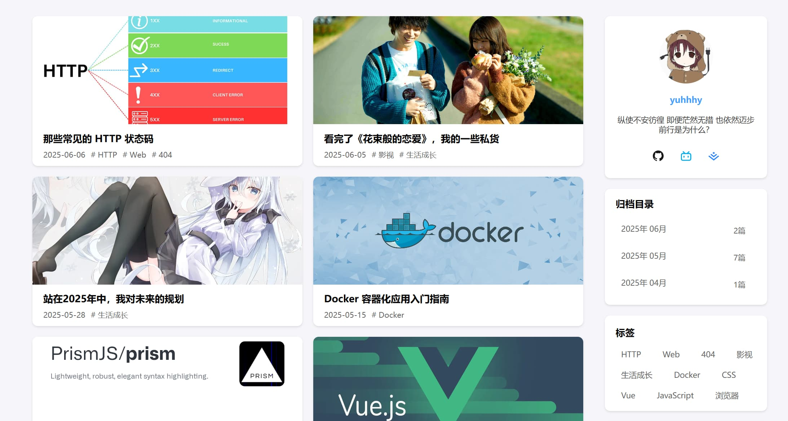
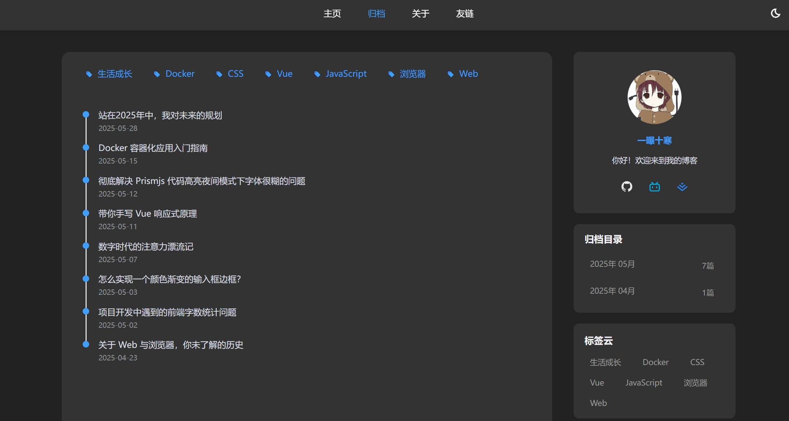

## 技术栈
### 前端
- Vue3
- VueRouter
- Axios
- Pinia
- Sass
- Element-Plus
- Vite
### 后端
- Koa3
- MongoDB
- mongoose
## 后台管理
- Vue3
- Element-Plus
- Tailwind CSS


## 项目预览
在线地址: 
https://yuhhhy.cn

### 首页

### 归档页（黑暗模式展示）

### 文章详情页


## 实现功能
### 整体
- 博客
- 博客列表
- 博客归档
- 发表和显示评论
- 关于页面
- 友链页面
- 适配移动端
- 更多功能开发中……

### 后端
- 博客API
- 博客内容API
- 网站数据API
- 评论API
- 用户API
- 访客API

## 项目结构
```
blog-vue-koa/
├─ blog-background/         // Vue 博客后台管理
│   ├─ src/                     // 项目源码
│   │   ├─ api/                 // 前端api接口
│   │   ├─ assets/              // 前端静态资源
│   │   ├─ components/          // Vue组件
│   │   ├─ config/              // 环境配置
│   │   ├─ js/                  // JavaScript 模块
│   │   ├─ router/              // 路由
│   │   ├─ stores/              // Pinia
│   │   ├─ style/               // 基础样式
│   │   ├─ utils/               // 工具函数
│   │   ├─ views/               // Vue页面
│   │   ├─ App.vue              // 根组件
│   │   └─ main.js              // 初始化Vue实例的入口文件
│   ├─ index.html               // 项目入口文件
│   ├─ package.json             // 项目依赖
│   ├─ ...                      // 其他配置文件
│   └─ vite.config.js           // vite配置文件
├─ blog-client/             // Vue 博客前端
│   ├─ src/                     // 项目源码
│   │   ├─ api/                 // 前端api接口
│   │   ├─ assets/              // 前端静态资源
│   │   ├─ components/          // Vue组件
│   │   ├─ composables/         // 组合式函数
│   │   ├─ config/              // 环境配置
│   │   ├─ router/              // 前端路由
│   │   ├─ stores/              // Pinia
│   │   ├─ utils/               // 工具函数
│   │   ├─ views/               // Vue页面
│   │   ├─ App.vue              // 根组件
│   │   └─ main.js              // 初始化Vue实例的入口文件
│   ├─ index.html               // 项目入口文件
│   ├─ package.json             // 项目依赖
│   └─ vite.config.js           // vite配置文件
├─ blog-server/             // Koa 后端项目
│   ├─ config/              // 配置文件
│   ├─ controllers/         // 控制器
│   ├─ middlewares/         // 中间件
│   ├─ models/              // 数据模型
│   ├─ routes/              // 路由定义
│   ├─ scripts/             // 后端脚本
│   ├─ utils/               // 工具函数
│   ├─ app.js               // 应用主入口文件
│   └─ package.json         // 项目依赖
├─ assets/                    // 项目文档资源
│   └─ images/              // README 图片
├─ scripts/                   // CI/CD 发布脚本
│   ├─ deploy-release.sh
│   └─ prepare-release.js
├─ .gitignore                   // git忽略文件
├─ LICENSE                      // 开源协议
├─ package.json                 // 统一管理脚本
├─ pnpm-lock.yaml              // 锁定版本
├─ pnpm-workspace.yaml         // pnpm workspace 配置
└─  README.md                   // 项目说明文档
```


## 开发指南
1. 克隆项目
```bash
git clone https://github.com/yuhhhy/blog-vue-koa.git
```

2. 安装依赖
- 下载MongoDB并启动MongoDB服务
https://www.mongodb.com/try/download/community

- 安装Nodejs
https://nodejs.org/

- 启用 pnpm 并安装项目依赖
```
cd blog-vue-koa
corepack enable
pnpm install
```

3. 启动项目
```bash
pnpm start-all
```
